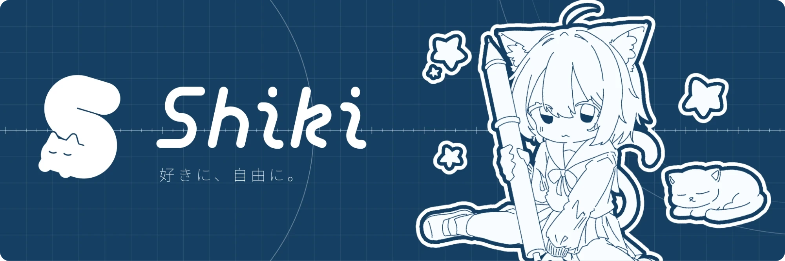
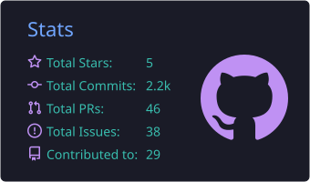
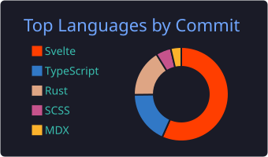

いろいろ作っては積んでいるえんじにあ。 
Web とインフラを中心に、ツールやアプリを Svelte と Rust で作っています。

## Now

- Web アプリとそのインフラ（Cloudflare Workers / Pages）
- Rust + Tauri でのデスクトップツール
- Unity / Blender での 3D・ゲーム制作

## Projects

| | Project | | Stack |
|---|---|---|---|
| ⌨️ | [**Nagi**](https://github.com/shiki-01/Nagi) | 小型のローカル LLM でかな漢字変換をする日本語 IME。macOS / Windows / iOS 向けに開発中。[nagi.shiki-01.com](https://nagi.shiki-01.com) | Rust / Swift |
| 🗂️ | [**Hikae**](https://github.com/shiki-01/Hikae) | Git の用語を出さずに「保存」と「履歴」だけで使える、非エンジニア向けのバックアップ・履歴管理アプリ | Tauri / Rust / Svelte |
| 📖 | [**Storift**](https://github.com/shiki-01/Storift) | 原稿・プロット・キャラクター・世界観をまとめて管理する小説執筆アプリ。PWA とデスクトップ版。[storift.shiki-01.com](https://storift.shiki-01.com) | Tauri / Svelte |
| 🧩 | [**Funbook**](https://github.com/shiki-01/Funbook) | ブロックを組み合わせてコードを生成するビジュアルブロックエディタ | Tauri / Svelte |
| 🐈‍⬛ | [**portfolio**](https://github.com/shiki-01/portfolio) | ポートフォリオサイト。[shiki-01.com](https://shiki-01.com) | SvelteKit / Cloudflare |

## Stack

**Languages**&nbsp;

**Frontend**&nbsp;

**Runtime / Infra**&nbsp;

**3D / Game**&nbsp;

## Sponsors

公開しているものは、すべて無料で使えます。開発を支援していただける場合は、[GitHub Sponsors](https://github.com/sponsors/shiki-01) から受け付けています。支援の有無で、使える機能は変わりません。

いただいた支援は、特定のプロジェクトに限らず、開発の時間と公開・配布の費用に使います。Storift は [BOOTH](https://shiki-01.booth.pm/items/9119351) からも支援できます。

### Thanks

支援を「公開」に設定してくださった方を、GitHub のユーザー名で載せています。ありがとうございます。載せたくない場合は、支援の設定を「非公開」に変えてください。

<!-- sponsors -->まだいません。<!-- /sponsors -->

## Stats

---

二度繰り返す 🌙

